# CompreFácil: pagamento e notificação com microsserviços

Desafio 2 de **Desenvolvimento de Sistemas Distribuídos** (Análise e Desenvolvimento de Sistemas, Centro Universitário SENAI/SC – UniSENAI).

Dois microsserviços Node.js independentes, um de **pagamento** e um de **notificação**, que conversam de forma **assíncrona pelo RabbitMQ**. Cada um tem o próprio banco Postgres. Quando um pagamento é solicitado, ele é gravado como pendente, o cliente é avisado do recebimento, o pagamento é confirmado e o cliente é avisado da confirmação, sem que um serviço chame o outro diretamente.

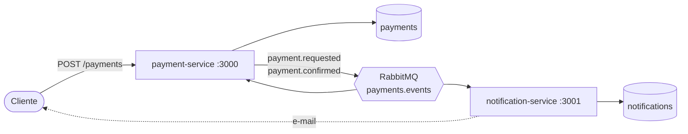

## Sumário

- [Critérios de avaliação](#critérios-de-avaliação)
- [Pré-requisitos](#pré-requisitos)
- [Como executar](#como-executar)
- [Testando o fluxo](#testando-o-fluxo)
- [API](#api)
- [Mensageria](#mensageria)
- [Resiliência: roteiros para ver funcionando](#resiliência-roteiros-para-ver-funcionando)
- [Testes automatizados](#testes-automatizados)
- [Prints da execução](#prints-da-execução)
- [Desenvolvimento local](#desenvolvimento-local)
- [Estrutura do repositório](#estrutura-do-repositório)
- [Decisões de arquitetura](#decisões-de-arquitetura)

## Critérios de avaliação

| Critério | Como o projeto atende |
| --- | --- |
| **1. Serviços independentes** | `payment-service/` e `notification-service/` são projetos separados (cada um com `package.json`, Dockerfile, banco e processo próprios). Não compartilham código nem banco; o único contrato entre eles é o evento JSON no RabbitMQ. Com a notificação parada, o pagamento continua aceitando e confirmando transações. |
| **2. Comunicação assíncrona via mensageria** | O pagamento publica eventos na exchange `payments.events` do RabbitMQ (AMQP); a notificação consome da fila dela. Nenhuma chamada HTTP entre serviços. `POST /payments` responde **202 Accepted** sem esperar a confirmação. |
| **3. Fluxo de processamento solicitado** | Os 6 passos (I a VI) são executados e verificados pelo teste ponta a ponta (`npm run test:e2e`). O mapa passo → código está em [docs/arquitetura.md](docs/arquitetura.md#o-fluxo-do-enunciado-passo-a-passo). |

Além do mínimo: outbox transacional (nenhum evento se perde se o RabbitMQ cair), topologia do RabbitMQ provisionada no boot, consumidores idempotentes, ack manual com nova tentativa e DLQ, reconexão automática, desligamento gracioso, health checks, Swagger, testes unitários, testes ponta a ponta e testes de resiliência que derrubam contêineres de verdade.

## Pré-requisitos

| Ferramenta | Versão | Para quê |
| --- | --- | --- |
| Docker + Docker Compose v2 | Docker 24+ | subir tudo (obrigatório) |
| Node.js | 20 ou 22 | só para a demo, os testes e o modo de desenvolvimento |

Portas usadas no host, todas publicadas só em `127.0.0.1`: `3000`, `3001`, `5672`, `15672` e `55432` (Postgres; fica fora da 5432 para não brigar com um Postgres local). Todas podem ser trocadas por variáveis; veja [.env.example](.env.example).

## Como executar

```bash
git clone https://github.com/AmandaPardinho/desafio-2-sistemas-distribuidos.git
cd desafio-2-sistemas-distribuidos
docker compose up --build -d
```

O compose sobe **Postgres**, **RabbitMQ** e os **dois serviços**, aplica as migrations do banco e só libera os serviços quando o banco e o broker estão saudáveis. Para acompanhar:

```bash
docker compose ps
docker compose logs -f payment-service notification-service
```

| O quê | Endereço |
| --- | --- |
| API de pagamento (Swagger) | http://localhost:3000/docs |
| API de notificação (Swagger) | http://localhost:3001/docs |
| Painel do RabbitMQ | http://localhost:15672 (usuário `admin`, senha `123456`) |

Para desligar: `docker compose down` (mantém os dados) ou `docker compose down -v` (apaga os dados).

> **Atualizando de uma versão anterior deste repositório:** as filas passaram a ser *quorum queues*, e o RabbitMQ não converte uma fila já existente. Rode `docker compose down -v` antes do `up` (apaga os dados locais).

## Testando o fluxo

### Opção 1: demonstração guiada

```bash
npm run demo
```

```text
CompreFácil: demonstração do fluxo de pagamento

1. POST http://localhost:3000/payments
   202 Accepted, status PENDING +0.1s

2. Acompanhando GET /payments/caa469a6… e GET /notifications
   e-mail PAYMENT_REQUESTED para cliente@comprefacil.com.br +0.4s
          Recebemos o pagamento do pedido DEMO-A966802E
   status PENDING → SUCCESS +3.5s
   e-mail PAYMENT_CONFIRMED para cliente@comprefacil.com.br +3.5s
          Pagamento do pedido DEMO-A966802E confirmado

Fluxo concluído: pagamento confirmado e cliente notificado duas vezes.
```

### Opção 2: passo a passo com `curl`

```bash
curl -i -X POST http://localhost:3000/payments \
  -H "Content-Type: application/json" \
  -d '{"orderId":"PED-1001","customerId":"CLI-42","customerEmail":"cliente@comprefacil.com.br","amount":259.90}'
```

```http
HTTP/1.1 202 Accepted
Location: /payments/57a57a6d-4593-4a75-b17a-ba74d888c8c5

{"id":"57a57a6d-…","orderId":"PED-1001","amount":"259.90","currency":"BRL","status":"PENDING", …}
```

Logo em seguida (o processamento simulado leva 3 segundos):

```bash
curl http://localhost:3000/payments/<id>                        # status SUCCESS e confirmedAt
curl "http://localhost:3001/notifications?paymentId=<id>"       # PAYMENT_REQUESTED e PAYMENT_CONFIRMED
docker compose logs notification-service | grep EmailSender     # os dois e-mails "enviados"
```

```text
[EmailSender] E-mail enviado para cliente@comprefacil.com.br | Recebemos o pagamento do pedido PED-1001 | Olá! Recebemos a solicitação de pagamento de R$ 259,90 referente ao pedido PED-1001. Ela está em processamento e avisaremos assim que for confirmada. [chave be9bd030-…]
[EmailSender] E-mail enviado para cliente@comprefacil.com.br | Pagamento do pedido PED-1001 confirmado | Tudo certo! O pagamento de R$ 259,90 referente ao pedido PED-1001 foi confirmado. Obrigado por comprar na CompreFácil. [chave d3519751-…]
```

Para conferir direto no banco:

```bash
docker exec comprefacil-postgres psql -U postgres -d payments -c "select order_id, status, confirmed_at from payments;"
```

## API

### payment-service (`:3000`)

| Método | Rota | Resposta |
| --- | --- | --- |
| `POST` | `/payments` | **202** pagamento criado como `PENDING` · **400** corpo inválido · **409** pedido já tem pagamento |
| `GET` | `/payments/:id` | **200** pagamento com status atual · **404** não existe · **400** id não é UUID |
| `GET` | `/health` | **200** banco e broker no ar · **503** alguma dependência fora |

Corpo do `POST /payments`:

| Campo | Tipo | Regra |
| --- | --- | --- |
| `orderId` | texto | obrigatório, até 64 caracteres, único |
| `customerId` | texto | obrigatório, até 64 caracteres |
| `customerEmail` | e-mail | obrigatório; recebe as notificações |
| `amount` | número | maior que zero, até 2 casas decimais, até 1.000.000 |

Status possíveis: `PENDING` (pendente) → `SUCCESS` (sucesso).

### notification-service (`:3001`)

| Método | Rota | Resposta |
| --- | --- | --- |
| `GET` | `/notifications?paymentId=<uuid>` | notificações do pagamento, em ordem de envio (sem filtro: as 100 mais recentes) |
| `GET` | `/health` | **200** · **503** |

## Mensageria

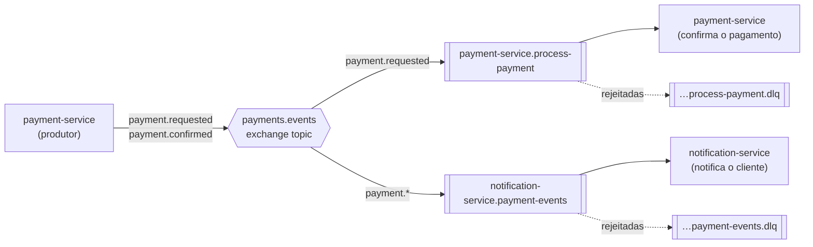

| Elemento | Configuração |
| --- | --- |
| Topologia | provisionada pelo RabbitMQ no boot ([infra/rabbitmq/definitions.json](infra/rabbitmq/definitions.json)); as filas existem antes de qualquer serviço subir |
| Exchange | `payments.events`, tipo `topic`, durável |
| Filas | *quorum queues* duráveis, com até 3 reentregas (`x-delivery-limit`) e dead-letter para a DLQ correspondente |
| Mensagens | persistentes, JSON, `messageId` único por evento, confirmadas pelo broker (*publisher confirms*) |
| Consumo | ack manual no canal que entregou; `prefetch` 10 no processamento do pagamento e 1 na notificação |
| Falha temporária | nova tentativa com intervalo crescente (1 s, 2 s, 3 s); depois do limite, DLQ |

Formato do evento:

```json
{
  "eventId": "be9bd030-9846-4d88-9dca-b9258282d369",
  "type": "payment.requested",
  "occurredAt": "2026-11-21T03:46:14.010Z",
  "data": {
    "paymentId": "57a57a6d-4593-4a75-b17a-ba74d888c8c5",
    "orderId": "PED-1001",
    "customerId": "CLI-42",
    "customerEmail": "cliente@comprefacil.com.br",
    "amount": "259.90",
    "currency": "BRL",
    "status": "PENDING"
  }
}
```

## Resiliência: roteiros para ver funcionando

Os cenários abaixo estão automatizados em `npm run test:resilience` (cerca de 1 minuto; derruba e religa contêineres de verdade). Para ver à mão:

**Notificação fora do ar: o pagamento continua independente.**

```bash
docker compose stop notification-service
npm run demo                                  # o status vira SUCCESS, mas nenhum e-mail sai (a demo avisa após 30 s)
docker compose start notification-service    # os eventos que esperavam na fila são entregues, na ordem
```

**RabbitMQ fora do ar: nenhum evento se perde.**

```bash
docker compose stop rabbitmq
curl -X POST http://localhost:3000/payments -H "Content-Type: application/json" \
  -d '{"orderId":"PED-SEM-BROKER","customerId":"CLI-1","customerEmail":"cliente@comprefacil.com.br","amount":99.99}'
                                              # 202 PENDING: o evento fica guardado no outbox
docker compose start rabbitmq                 # o serviço reconecta, publica o evento, confirma e notifica
```

**Desligamento no meio do processamento.** `docker compose stop payment-service` durante os 3 s da operadora: o serviço para de receber mensagens, termina a que está em andamento e só então sai (log: "Aguardando 1 mensagem(ns) em processamento").

**Mensagem duplicada ou inválida.** Uma mensagem repetida é reconhecida pelo `eventId` e ignorada; uma mensagem malformada vai para a DLQ (veja no painel do RabbitMQ, aba *Queues*).

## Testes automatizados

```bash
cd payment-service && npm ci && npm test        # 54 testes unitários
cd notification-service && npm ci && npm test   # 42 testes unitários
npm run test:e2e                                 # 7 testes ponta a ponta (com o compose no ar)
npm run test:resilience                          # 5 testes de resiliência (com o compose no ar)
```

- **Unitários (Jest):** regras do pagamento (pendente → sucesso, idempotência, 409), relay do outbox (ordem, falha no meio do lote, broker desconectado), regra de ack/nack/DLQ, validação do contrato do evento, templates e idempotência da notificação.
- **Ponta a ponta (`node:test`):** cria uma transação real e verifica os 6 passos do enunciado, a ordem das notificações e as regras da API.
- **Resiliência (`node:test` + Docker):** notificação fora do ar, RabbitMQ fora do ar, fila recriada pelo broker antes do consumidor, mensagem duplicada, mensagem inválida e falha temporária do banco (novas tentativas com intervalo crescente até a DLQ).

## Prints da execução

Capturados da execução real, com o `docker compose` no ar. Os arquivos estão em [docs/prints/](docs/prints/).

**Os 4 contêineres saudáveis.**

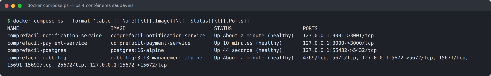

**Demonstração guiada (`npm run demo`).**

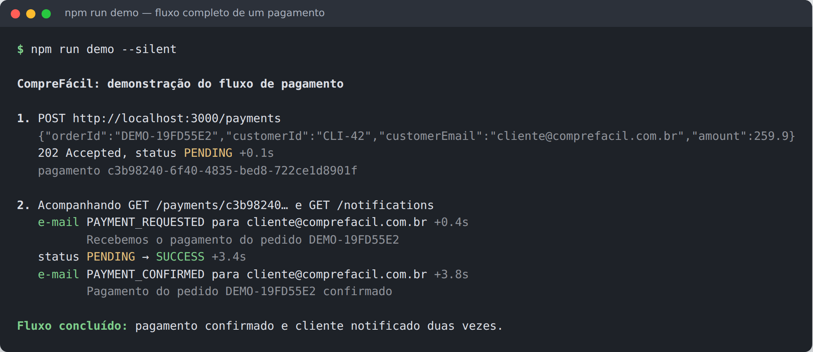

**Passo I: `POST /payments` responde 202 com status PENDING.**

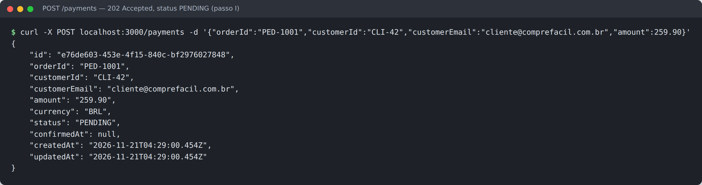

**Passos IV e VI: o pagamento virou SUCCESS e o cliente recebeu as duas notificações.**

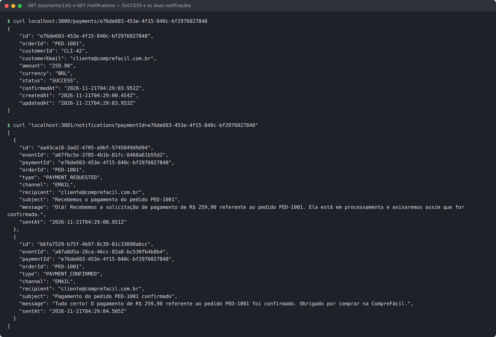

**Os 6 passos nos logs dos dois serviços, em ordem no tempo. A notificação de recebimento (passo III) e a autorização na operadora (início do passo IV) acontecem no mesmo milissegundo: são ramos paralelos (veja a [decisão 8](docs/arquitetura.md#8-ordem-do-fluxo-por-que-os-passos-iii-e-iv-correm-em-paralelo)).**

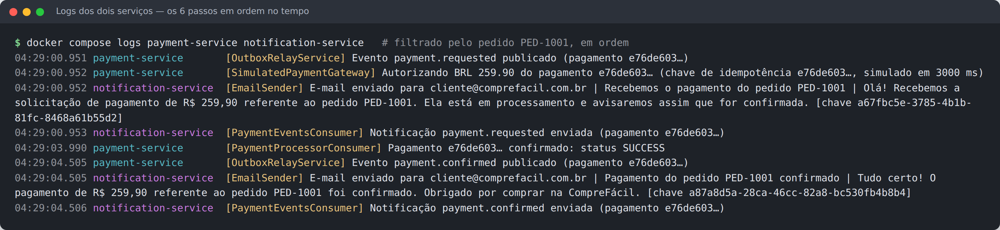

**O que ficou gravado: banco `payments`, banco `notifications` e o outbox com os dois eventos publicados.**

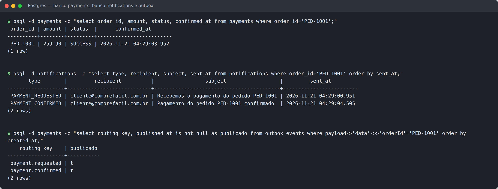

**Testes unitários do pagamento.**

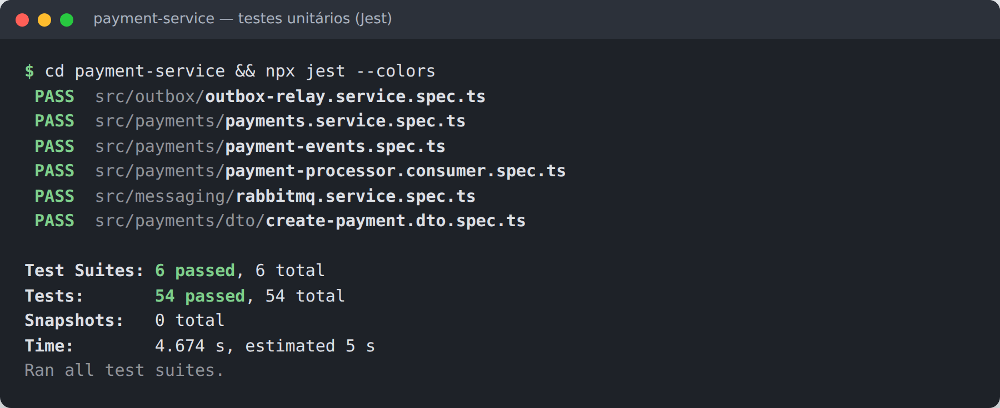

**Testes unitários da notificação.**

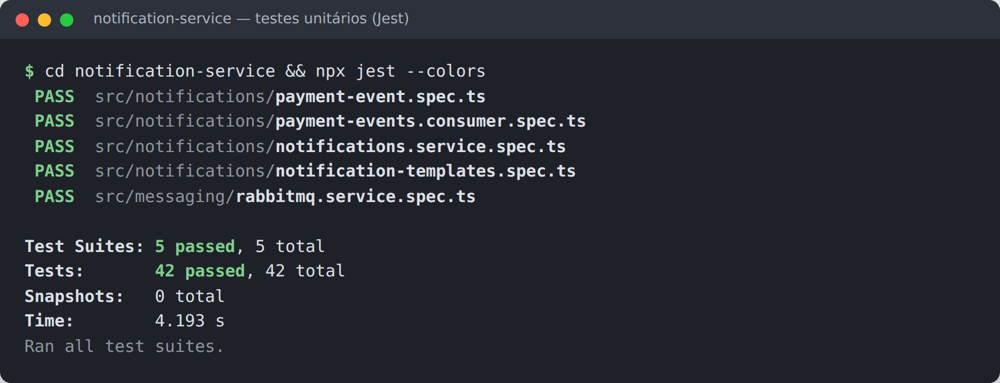

**Teste ponta a ponta.**

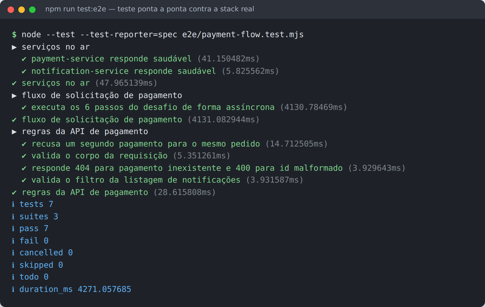

**Testes de resiliência, derrubando contêineres de verdade.**

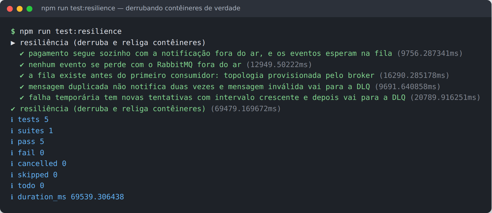

**Swagger do serviço de pagamento (http://localhost:3000/docs).**

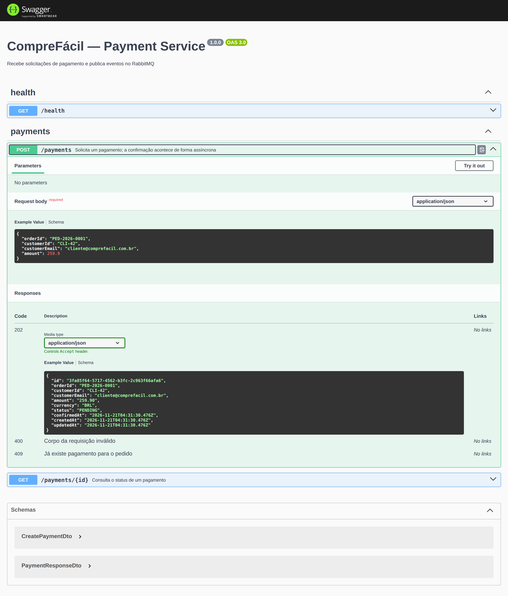

**Swagger do serviço de notificação (http://localhost:3001/docs).**

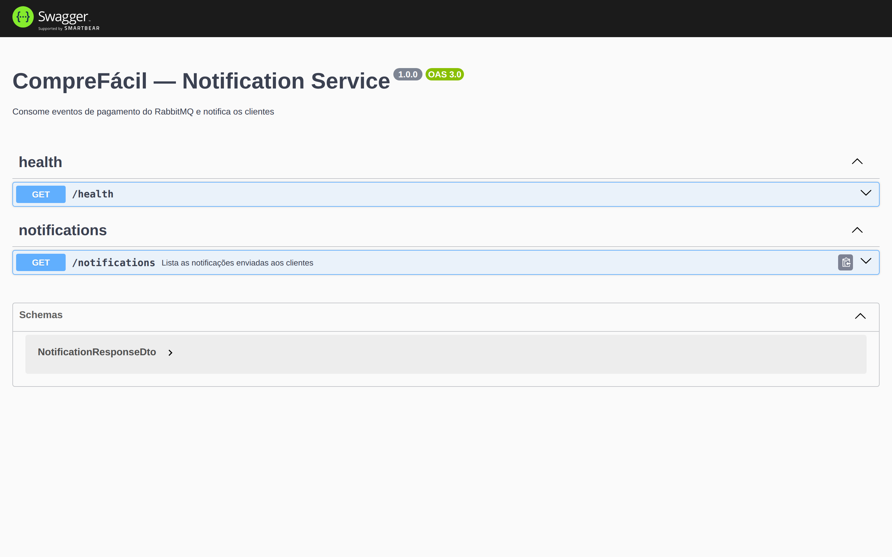

**Filas no painel do RabbitMQ. As duas filas principais são *quorum*; as mensagens nas DLQs são as inválidas e as que esgotaram as tentativas, enviadas de propósito pelos testes de resiliência.**

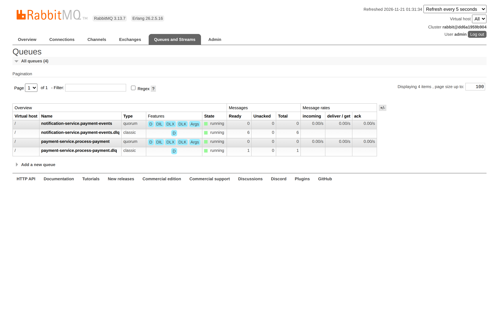

**Exchange `payments.events` e seus bindings: `payment.*` vai para a notificação, e `payment.requested` vai para o processamento do pagamento.**

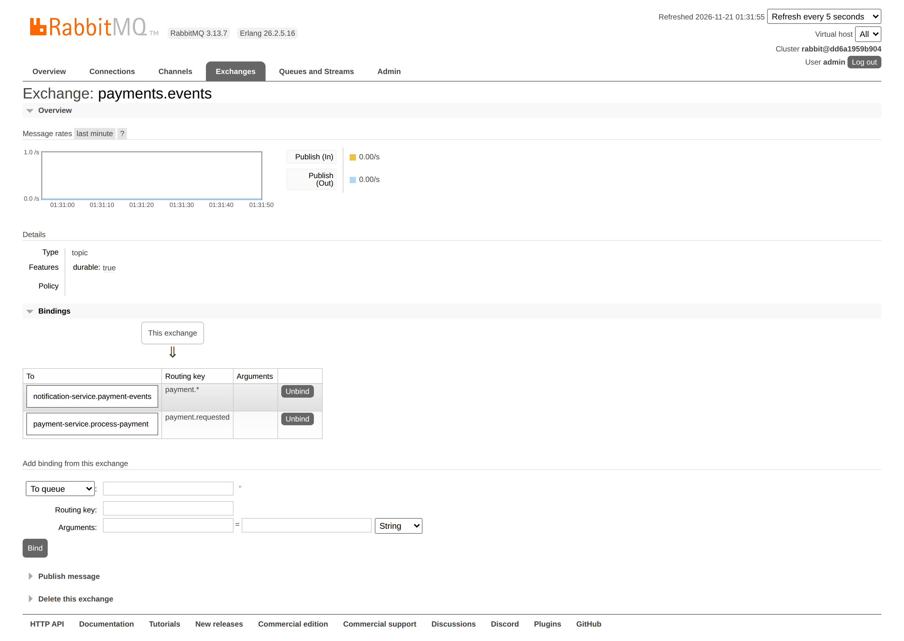

## Desenvolvimento local

Para rodar os serviços fora do Docker, com recarga automática:

```bash
docker compose up -d postgres rabbitmq

cd payment-service
cp .env.example .env
npm install
npx prisma migrate deploy
npm run start:dev

# em outro terminal
cd notification-service
cp .env.example .env
npm install
npx prisma migrate deploy
npm run start:dev
```

Outros comandos de cada serviço: `npm run lint`, `npm run build`, `npm run test:cov`.

A demo e os testes da raiz usam os endereços padrão. Se você trocar as portas no `.env`, informe também: `PAYMENT_URL` (padrão `http://localhost:3000`), `NOTIFICATION_URL` (`http://localhost:3001`) e `RABBITMQ_API` (`http://localhost:15672/api`). Exemplo: `PAYMENT_URL=http://localhost:3100 npm run demo`.

Variáveis de ambiente (com valores padrão):

| Variável | Serviço | Padrão |
| --- | --- | --- |
| `PORT` | ambos | `3000` / `3001` |
| `DATABASE_URL` | ambos | obrigatória |
| `RABBITMQ_URL` | ambos | obrigatória |
| `PAYMENT_CONFIRMATION_DELAY_MS` | pagamento | `3000` (tempo simulado da operadora) |
| `OUTBOX_POLL_INTERVAL_MS` | pagamento | `500` |
| `PROCESSING_PREFETCH` | pagamento | `10` |
| `NOTIFICATION_PREFETCH` | notificação | `1` |
| `RETRY_BASE_DELAY_MS` | ambos | `1000` (intervalo base da nova tentativa) |

## Estrutura do repositório

```text
.
├── docker-compose.yml          # Postgres, RabbitMQ e os dois serviços
├── infra/postgres/             # cria os bancos payments e notifications
├── infra/rabbitmq/             # topologia (exchange, filas, DLQs, bindings) e usuário do broker
├── payment-service/
│   ├── prisma/                 # schema e migrations (payments, outbox_events)
│   └── src/
│       ├── payments/           # REST, regra de negócio, consumidor que confirma
│       ├── outbox/             # gravação e relay dos eventos
│       ├── messaging/          # conexão, topologia e ack/nack do RabbitMQ
│       ├── health/
│       └── config/
├── notification-service/
│   ├── prisma/                 # schema e migrations (notifications)
│   └── src/
│       ├── notifications/      # consumidor, templates, envio, REST
│       ├── messaging/
│       ├── health/
│       └── config/
├── e2e/                        # testes ponta a ponta e de resiliência
├── scripts/demo.mjs            # demonstração guiada
├── docs/arquitetura.md         # decisões de arquitetura e o porquê de cada uma
└── docs/prints/                # prints da execução
```

## Decisões de arquitetura

O porquê de cada escolha (outbox, idempotência, exchange topic, retry e DLQ, topologia no boot, por que os passos III e IV correm em paralelo, um banco por serviço, versões fixadas) e o que ficou fora do escopo estão em **[docs/arquitetura.md](docs/arquitetura.md)**.

Projetos de referência indicados no enunciado: [ms-payment-service](https://github.com/thiagoromendes/ms-payment-service) e [ms-notification-service](https://github.com/thiagoromendes/ms-notification-service).
