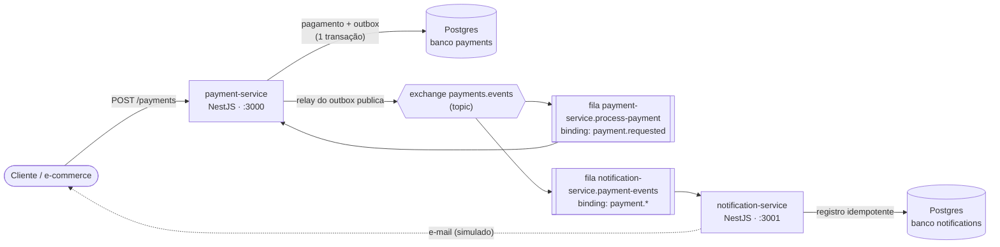
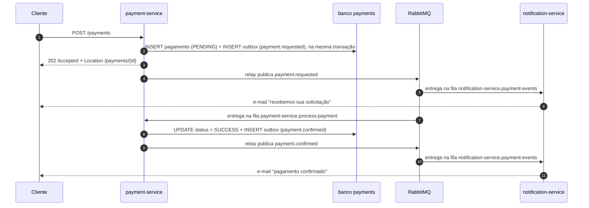

# Arquitetura e decisões

Este documento explica **por que** o código é do jeito que é. O código não tem comentários didáticos de propósito; cada decisão está justificada aqui e ligada ao conceito da disciplina que ela aplica.

## Visão geral

São dois serviços **independentes**: cada um tem o próprio `package.json`, o próprio processo, a própria imagem Docker e o próprio banco. O único ponto de contato entre eles é o **contrato do evento** que trafega pelo RabbitMQ. Nenhum chama o outro por HTTP.

## O fluxo do enunciado, passo a passo

| Passo do enunciado | Onde acontece |
| --- | --- |
| I. armazena a transação como pendente | `PaymentsService.requestPayment`, que grava `status = PENDING` |
| II. publica mensagem para a notificação | evento `payment.requested` gravado no outbox e publicado pelo `OutboxRelayService` |
| III. notificação lê e avisa o recebimento | `PaymentEventsConsumer` → `NotificationsService.notify` (`PAYMENT_REQUESTED`) |
| IV. confirma e atualiza para sucesso | `PaymentProcessorConsumer` → `PaymentsService.confirmPayment` (`status = SUCCESS`) |
| V. publica mensagem de confirmação | evento `payment.confirmed` gravado no outbox na mesma transação do passo IV |
| VI. notificação lê e avisa a confirmação | `PaymentEventsConsumer` → `NotificationsService.notify` (`PAYMENT_CONFIRMED`) |

## Decisões

### 1. NestJS + Prisma + amqplib, com versões fixadas

- **Decisão:** NestJS 11, Prisma 6 e `amqplib` 0.10 com `amqp-connection-manager` 4, todas com versão exata no `package.json`.
- **Por quê:** os projetos de referência do professor (`ms-payment-service` e `ms-notification-service`) e as videoaulas usam NestJS + ORM + RabbitMQ. As linhas novas (Nest 12, Prisma 7+) mudaram APIs; fixar versões maduras garante que `npm ci` reproduz exatamente o que foi testado.
- **Diferença em relação à referência:** a referência usa o transporte RMQ do `@nestjs/microservices`, que esconde exchange, binding e ack. Aqui o `amqplib` é usado diretamente (pelo `amqp-connection-manager`, que só cuida da reconexão), para que cada conceito da apostila (exchange, fila durável, mensagem persistente, ack manual, prefetch) apareça explícito no código.

### 2. Um banco por serviço

- **Decisão:** um servidor Postgres com dois bancos lógicos, `payments` e `notifications`. Cada serviço só enxerga o seu.
- **Por quê:** é o padrão *database per service* do e-book "Uso da Persistência de Dados em Sistemas Distribuídos". A própria apostila sugere a variação adotada aqui: bancos **lógicos** no mesmo servidor, quando os serviços usam o mesmo SGBD. A notificação não consulta a tabela de pagamentos; tudo de que ela precisa chega no evento.

### 3. Comunicação assíncrona por exchange `topic`

- **Decisão:** o pagamento publica em uma exchange `payments.events` do tipo `topic`, com routing keys `payment.requested` e `payment.confirmed`. A notificação liga a fila dela com o padrão `payment.*`; o processador de pagamento liga a dele só com `payment.requested`.
- **Por quê:** é o **padrão de tópicos** da apostila (e-book "Comunicação entre Sistemas Distribuídos"). O produtor não conhece os consumidores: ele publica o evento, e cada consumidor escolhe o que assina. Um terceiro serviço (estoque, por exemplo) poderia assinar `payment.confirmed` sem mudar uma linha do pagamento.
- **Mensagem com cara de evento:** `messageId` = `eventId`, `type` = routing key, `correlationId` = id do pagamento, `contentType` JSON, `persistent: true`.

### 4. Outbox transacional (o "pulo do gato")

- **Problema:** "gravar no banco" e "publicar no RabbitMQ" são duas operações em dois sistemas. Se o serviço grava o pagamento e cai antes de publicar, o pagamento fica PENDING para sempre e o cliente nunca é avisado. Se publica antes de gravar e a gravação falha, a notificação avisa de um pagamento que não existe. Esse é o problema do *dual write*.
- **Decisão:** o evento é gravado na tabela `outbox_events` **na mesma transação** do pagamento. Um relay (`OutboxRelayService`) lê os eventos pendentes a cada 500 ms, publica com **confirmação do broker** (*publisher confirms*) e só então marca `published_at`.
- **Consequências:**
  - O RabbitMQ pode estar fora do ar: a API continua aceitando pagamentos (202), e os eventos saem quando o broker volta. Isso foi testado derrubando o contêiner do RabbitMQ.
  - A leitura usa `FOR UPDATE SKIP LOCKED`, então várias instâncias do pagamento podem rodar ao mesmo tempo sem publicar o mesmo evento em paralelo (**escalabilidade horizontal** sem **condição de corrida**).
  - A garantia é *at-least-once* (entrega pelo menos uma vez): se o relay publicar e cair antes de marcar, o evento sai de novo. Por isso os consumidores são idempotentes (decisão 6).

### 5. Confirmação do pagamento por fila, não por `setTimeout`

- **Decisão:** a confirmação (passo IV) é feita por um consumidor da fila `payment-service.process-payment`, que chama a operadora de cartão (simulada pelo `SimulatedPaymentGateway`, 3 s por padrão) e então atualiza o status.
- **Por quê:** a referência usa `setTimeout` em memória; se o processo reinicia nesse intervalo, o pagamento nunca é confirmado. Com a fila durável e o ack manual, uma confirmação interrompida volta para a fila e é retomada. É o padrão de **consumidores concorrentes** da apostila: subir mais instâncias divide o trabalho automaticamente (`prefetch` 10).
- **Simulação explícita:** não existe operadora real; o gateway é uma classe abstrata (`PaymentGateway`), e trocar pela integração real é trocar um provider no módulo.

### 6. Idempotência nos dois consumidores

- **Por quê:** o RabbitMQ entrega *pelo menos uma vez* (seção "Idempotência no processamento de mensagens" da apostila). Mensagem repetida não pode cobrar nem notificar duas vezes.
- **No pagamento, em três camadas:**
  1. antes de chamar a operadora, o consumidor confere se o pagamento ainda está `PENDING`; reentrega de pagamento já confirmado recebe ack sem nova cobrança;
  2. a operadora recebe uma **chave de idempotência** (o id do pagamento), que é como gateways reais (Stripe, Adyen, Pagar.me) evitam cobrar duas vezes quando duas entregas chegam ao mesmo tempo;
  3. o `UPDATE ... WHERE id = ? AND status = 'PENDING'` garante que só uma entrega muda o status e gera o `payment.confirmed`.
- **Na notificação:** a tabela `notifications` tem `event_id UNIQUE`. O registro e o envio acontecem na mesma transação; um evento repetido bate na unicidade (`P2002`), é reconhecido como duplicado e recebe ack sem reenviar o e-mail. O envio também leva o `eventId` como chave de idempotência para o provedor.
- Testado (e automatizado em `npm run test:resilience`) publicando à mão, pela API do RabbitMQ, um evento já processado.

### 7. Ack manual, nova tentativa com intervalo crescente e DLQ

As filas principais são **quorum queues** com `x-delivery-limit: 3`: o próprio RabbitMQ conta as entregas de cada mensagem (cabeçalho `x-delivery-count`) e, passado o limite, manda para a DLQ.

| Situação | O que acontece | Por quê |
| --- | --- | --- |
| Processou com sucesso | `ack` | a mensagem só sai da fila depois do trabalho feito |
| Mensagem inválida (JSON quebrado, contrato errado) | `nack` sem requeue → DLQ na hora | tentar de novo não conserta; vai para análise |
| Erro inesperado (ex.: banco fora) | espera 1 s × tentativa e faz `nack` com requeue | falha temporária: **retry** com intervalo crescente (1 s, 2 s, 3 s…) |
| Passou de 3 reentregas | o broker manda para a DLQ | **retry limitado**, como pede a apostila; sem loop infinito |

- **Por que não usar `redelivered`:** a flag `redelivered` também fica verdadeira quando o serviço cai antes do ack, então ela não conta tentativas da aplicação. O `x-delivery-count` da quorum queue conta, e é mantido pelo broker.
- Testado derrubando o Postgres: o log mostrou as tentativas 1 a 4 com intervalo crescente, e a mensagem terminou na DLQ.
- Cada fila tem uma DLQ (`*.dlq`) configurada por `x-dead-letter-exchange` usando a *default exchange*, o que dispensa uma exchange extra.

### 8. Ordem do fluxo: por que os passos III e IV correm em paralelo

- **O que o enunciado pede:** "o fluxo a seguir deve ser **assíncrono**". Depois do passo II, o `payment.requested` vai, ao mesmo tempo, para duas filas: a da notificação (passo III) e a do processamento do pagamento (passo IV). São dois ramos independentes.
- **Alternativa descartada:** fazer o pagamento esperar a notificação confirmar o envio do passo III antes de confirmar (passo IV). Isso deixaria o pagamento **dependente da disponibilidade da notificação**: com ela fora do ar, nenhum pagamento seria confirmado. Fere o critério 1 (serviços independentes) e o motivo de usar mensageria.
- **Mesma leitura do projeto de referência:** o `ms-payment-service` indicado no enunciado também publica o evento de registro e confirma o pagamento depois de um intervalo (`setTimeout` de 10 s), sem esperar a notificação. Este projeto segue essa leitura do fluxo, trocando o `setTimeout` em memória por uma fila durável (decisão 5).
- **O que é garantido para o cliente:** ele recebe "recebemos" **antes** de "confirmado". O `payment.confirmed` só nasce depois que o `payment.requested` já está na fila da notificação; a fila é FIFO e a notificação consome com `prefetch 1`. Mesmo com a notificação parada, os dois eventos esperam na ordem certa (testado). O teste e2e verifica essa ordem.

### 9. REST nos dois serviços

| Serviço | Endpoint | Para quê |
| --- | --- | --- |
| pagamento | `POST /payments` | solicita a transação; responde **202 Accepted** + `Location` |
| pagamento | `GET /payments/:id` | consulta o status (PENDING → SUCCESS) |
| notificação | `GET /notifications?paymentId=` | consulta o que foi enviado ao cliente |
| ambos | `GET /health` | banco e broker; 503 se algum estiver fora |
| ambos | `GET /docs` | Swagger |

O **202** é intencional: a resposta não espera a confirmação, como no exemplo da apostila em que o serviço devolve uma URL de acompanhamento em vez de bloquear o chamador.

### 10. Regras de negócio da API

- Um pedido (`orderId`) só pode ter um pagamento: `UNIQUE` no banco, **409 Conflict** na API. É a quarta estratégia de idempotência citada na apostila ("regras de negócio que impeçam registros duplicados").
- Valor positivo, até 2 casas decimais e no máximo R$ 1.000.000,00; e-mail válido; campos extras rejeitados (`whitelist` + `forbidNonWhitelisted`).
- Dinheiro é `DECIMAL(12,2)` no banco e texto (`"259.90"`) no JSON de resposta, para nunca passar por ponto flutuante.

### 11. Desligamento e reconexão

- `amqp-connection-manager` reconecta sozinho e refaz a topologia e os consumidores (testado derrubando o broker).
- Cada mensagem recebe ack ou nack **no mesmo canal que a entregou**. Se a conexão caiu no meio do processamento, o canal antigo está fechado, a confirmação falha sem derrubar o serviço, e o broker reentrega a mensagem (tratada de forma idempotente).
- **Desligamento gracioso** (`docker compose stop`, SIGTERM): o serviço cancela os consumidores (para de receber), espera até 10 s pelas mensagens em andamento e só então fecha canais, conexão e banco. Testado parando o pagamento no meio dos 3 s da operadora: o log mostrou "Aguardando 1 mensagem(ns) em processamento", o pagamento foi confirmado e só depois o serviço saiu.
- Ordem no Nest: quem usa a infraestrutura para no `onModuleDestroy` (consumidores e relay); a infraestrutura fecha no `onApplicationShutdown` (Prisma e RabbitMQ).

### 12. Limites conhecidos (fora do escopo do desafio)

- **Envio de e-mail é simulado** (log estruturado + registro no banco), como na referência do professor. O `NotificationSender` é abstrato; um provedor SMTP real entraria como outro provider.
- **Efeito externo é "pelo menos uma vez".** Se o e-mail sair e o serviço cair antes do commit, a reentrega envia de novo. Nenhuma transação de banco desfaz um e-mail enviado; a defesa de mercado é a chave de idempotência no provedor (já enviada) ou um outbox de envio. O mesmo vale para a operadora, protegida pela chave de idempotência.
- **Não há fluxo de falha** (pagamento recusado / SAGA com compensação): o enunciado só pede o caminho de sucesso. O status é um enum, então `FAILED` entraria sem migração de tipo de dado.
- **Segurança de ambiente local:** todas as portas são publicadas só em `127.0.0.1`. As credenciais (`admin`/`123456` no RabbitMQ, `postgres`/`postgres` no banco) são as de laboratório da apostila. A API de notificações não tem autenticação; em produção ela ficaria atrás de um API Gateway com autenticação, porque expõe e-mails de clientes.

### 13. Topologia provisionada pelo broker

- **Problema:** se cada serviço declarasse só a própria fila, num broker recém-criado o pagamento poderia publicar antes de a notificação subir pela primeira vez. A fila dela ainda não existiria, a exchange não teria para onde rotear, e a notificação de recebimento se perderia (o *publisher confirm* só garante que o broker recebeu, não que havia fila).
- **Decisão:** a topologia inteira (exchange, filas, DLQs e bindings) é carregada pelo RabbitMQ no boot, a partir de `infra/rabbitmq/definitions.json`. Quando qualquer serviço conecta, as filas já existem. Os serviços continuam declarando a topologia de forma idempotente, com os mesmos argumentos, para rodar também contra um broker sem o arquivo.
- **Consequência:** quando há arquivo de definições, o RabbitMQ não cria o usuário padrão das variáveis de ambiente. Por isso o usuário `admin` (senha `123456`, a da apostila) está no próprio arquivo, com a senha em hash.
- Testado (e automatizado): com a notificação parada, a fila dela foi apagada e o broker reiniciado; a fila voltou com o broker, guardou os eventos, e a notificação os entregou ao subir.
